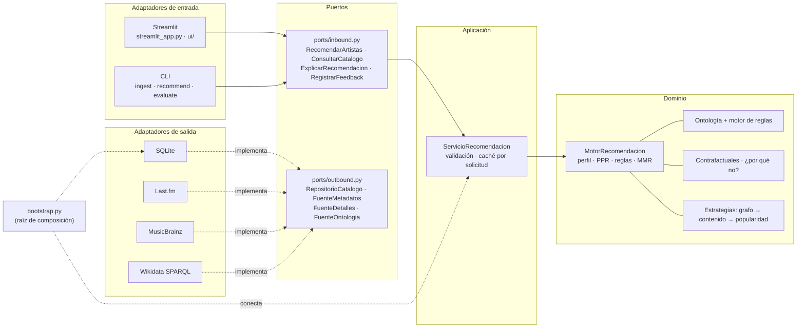
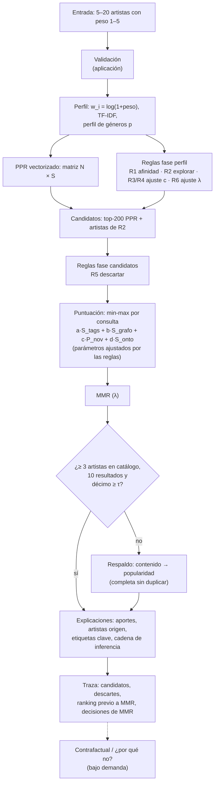

# SonarMatch

Prototipo de recomendación de artistas para el curso PTIA (Principios y Técnicas de IA). Es un
sistema **híbrido**: un razonamiento simbólico (ontología de géneros de Wikidata y un motor de
reglas propio) sobre un razonamiento numérico (Personalized PageRank y TF-IDF), con
explicaciones contrafactuales exactas.

## Qué es y qué problema resuelve

Dada una lista de 5 a 20 artistas que escucha una persona, cada uno con un peso de 1 a 5,
SonarMatch devuelve **10 artistas nuevos** con un puntaje y una explicación en español:

- qué artistas suyos y qué etiquetas pesaron más;
- qué reglas se dispararon (cadena de inferencia);
- qué pasaría sin cada uno de sus artistas (contrafactual);
- por qué *no* recomendó a un artista concreto.

**Alcance:** recomendación de artistas (no de canciones) sobre un catálogo de unos 5.000 artistas
con metadatos abiertos de Last.fm, MusicBrainz y Wikidata. Las consultas son síncronas y tardan
menos de 3 s; el contrafactual, menos de 1,5 s.

**Fuera de alcance:** cuentas de usuario y autenticación, aprendizaje a partir del feedback (solo
se registra), recomendación de canciones o listas, y cualquier modelo entrenado.

## Arquitectura hexagonal

El dominio no conoce SQLite, HTTP ni Streamlit. `import-linter` lo verifica con 4 contratos en
cada ejecución de `scripts/check.py`.



| Capa | Paquete | Responsabilidad |
|---|---|---|
| Dominio | `sonarmatch/domain/` | Perfil, puntuación, PPR, ontología, reglas, MMR, estrategias, explicaciones y contrafactuales. Sin infraestructura. |
| Puertos | `sonarmatch/ports/` | Contrato con el frontend (`inbound.py`, ver `docs/CONTRATO.md`) y con las fuentes de datos (`outbound.py`). |
| Aplicación | `sonarmatch/application/` | Valida solicitudes, traduce DTO ↔ dominio y cachea por solicitud la consulta y sus contrafactuales. |
| Adaptadores | `sonarmatch/adapters/` | Streamlit, CLI, SQLite y clientes HTTP. |
| Ingesta y evaluación | `sonarmatch/ingestion/`, `sonarmatch/evaluation/` | Procesos por lotes: poblar SQLite y medir el sistema. |

## Instalación y uso

Requiere Python 3.11 o superior.

```bash
python -m venv .venv && source .venv/bin/activate
pip install -e ".[dev]"
cp .env.example .env   # y completa las variables
```

| Variable | Uso |
|---|---|
| `LASTFM_API_KEY` | Clave de la API de Last.fm (solo para la ingesta real). |
| `MB_USER_AGENT` | User-Agent descriptivo con contacto, exigido por MusicBrainz y Wikidata. |
| `SONARMATCH_DB` | Ruta de la base SQLite (por defecto `data/sonarmatch.db`). |
| `SONARMATCH_PARAMS` | Opcional: JSON de parámetros calibrados (por defecto `reports/parametros_calibrados.json`). |
| `SONARMATCH_FAKE` | `1` para que la interfaz use los servicios falsos del contrato. |

```bash
# Ingesta real (≈5.000 artistas; reanudable: las respuestas quedan en la tabla api_cache)
python -m sonarmatch.adapters.inbound.cli ingest [--objetivo 5000] [--sin-musicbrainz]
# Sin API key: catálogo SINTÉTICO de demostración (51 artistas)
python -m sonarmatch.adapters.inbound.cli ingest --fixture

# Aplicación
streamlit run sonarmatch/adapters/inbound/streamlit_app.py

# Recomendación desde la terminal
python -m sonarmatch.adapters.inbound.cli recommend "Slowdive:5" "Low:4" "Beach House:3" "Cocteau Twins:3" "Mazzy Star:2"

# Evaluación (HetRec 2011, ver data/README.md) y calibración
python -m sonarmatch.adapters.inbound.cli evaluate [--dataset hetrec|csv] [--ruta ...]

# Mapeo de etiquetas reales (HetRec) contra Wikidata, sin API key de Last.fm
python scripts/mapeo_hetrec.py

# Todas las verificaciones de calidad
python scripts/check.py          # --rapido omite el benchmark
```

## Motor de razonamiento

Todos los hiperparámetros están en `sonarmatch/config.py` (`ConfigMotor`).

**Perfil.** w_i = log(1 + peso_i), normalizado para que Σ w_i = 1. Cada artista es un "documento"
de etiquetas ponderadas (`TfidfVectorizer`, solo para el vocabulario y el IDF; TF = peso/100,
filas normalizadas L2). perfil = Σ w_i · tfidf(artista_i), normalizado L2.

**Términos de cada candidato c:**

| Término | Definición |
|---|---|
| S_tags(c) | Coseno entre el perfil y tfidf(c). |
| S_grafo(c) | Personalized PageRank desde los artistas del usuario, sobre el grafo no dirigido de similitud (peso = `match` de Last.fm), con damping 0,85, tolerancia 1e-6 y 100 iteraciones como máximo. |
| P_nov(c) | 1 − log(1 + oyentes_c) / log(1 + oyentes_max). |
| S_onto(c) | Σ_g p_g · max_{h ∈ q_c} sim_wp(g, h) (ver "Capa simbólica"). |

**PPR vectorizado y explicaciones exactas.** El PPR se calcula por iteración de potencias para
todas las semillas a la vez, como una matriz N × S en la que cada columna es el PPR desde un
artista del usuario. Como el PPR es **lineal** en el vector de personalización, el PPR del
perfil es exactamente Σ w_i · PPR_i: una sola ejecución da el puntaje total y la contribución
de cada artista del usuario, que es lo que nombra la explicación ("muy conectado con Beach House
y Cocteau Twins"). Esa misma linealidad permite quitar un artista en el contrafactual sin volver
a correr PPR. Las pruebas comparan cada columna con `networkx.pagerank`.

**Candidatos:** top-K por PPR (K = 200) más los que aporta la regla R2, sin los artistas de la
entrada ni los descartados por R5.

**Combinación:** cada término se normaliza con min-max sobre los candidatos de la consulta, y
puntaje = a·S_tags + b·S_grafo + c·P_nov + d·S_onto, con a + b + c + d = 1 (por defecto 0,3,
0,35, 0,15 y 0,2). Los aportes ponderados suman exactamente el puntaje que se muestra.

**Diversidad (MMR):** se eligen los 10 de forma iterativa con
argmax[λ·puntaje(c) − (1 − λ)·max_{s ∈ S} cos(tfidf(c), tfidf(s))], con λ = 0,7. Por eso la
lista sigue el orden de MMR y el puntaje mostrado es la relevancia, que no siempre decrece.

**Cadena de respaldo:** Grafo → Contenido (TF-IDF sobre todo el catálogo) → Popularidad (más
escuchados dentro de las etiquetas dominantes del perfil). La siguiente estrategia se activa si:

1. menos de 3 artistas del usuario existen en el catálogo (se salta la principal);
2. la estrategia actual da menos de 10 resultados (se completa sin duplicar);
3. el puntaje combinado *sin normalizar* del décimo resultado es menor que τ (se conservan los
   que superan τ y se completa con la siguiente).

Cada recomendación registra su estrategia y la explicación lo menciona. Las reglas de la fase
perfil valen para todas las estrategias; R5, solo para la principal.

## Capa simbólica

### Ontología de géneros

- **Fuente:** Wikidata. Los QID se verificaron con consultas de prueba: Q188451 = "music genre",
  P31 = "instance of" y P279 = "subclass of". Se descargan los géneros (6.404) y las aristas
  P279 entre géneros (≈8.000) en dos consultas SPARQL con caché. El cierre de ancestros se
  calcula localmente y a la base solo pasan los géneros alcanzables desde etiquetas mapeadas y
  sus ancestros. Algunos géneros solo tienen la etiqueta por defecto `mul` (p. ej. Q3071,
  "punk rock"); se usa cuando falta la inglesa.
- **Estructura** (`domain/ontology.py`): un DAG con una raíz virtual sobre los géneros sin padre.
- **Ciclos:** Wikidata tiene ciclos en P279. Se rompen de forma determinista con un DFS (primero
  las raíces y luego el resto, en orden lexicográfico) que elimina las aristas de retroceso, y
  `aristas_rotas` registra cuáles se quitaron.
- **Profundidad:** distancia más corta desde la raíz virtual (BFS).
- **Wu-Palmer:** sim_wp(g, h) = max_{LCS ∈ ancestros comunes} 2·prof(LCS) / (prof(g) + prof(h)),
  acotada a 1, con la matriz precalculada y vectorizada.

### Mapeo de etiquetas de Last.fm a géneros

En orden de prioridad (`ingestion/genre_mapping.py`):

1. archivo manual `data/mapeo_manual.csv` (un qid vacío o `-` bloquea el mapeo automático);
2. coincidencia exacta con la etiqueta en inglés o español;
3. alias de Wikidata, más un alias derivado sin el sufijo "music" ("classical" → "classical music");
4. coincidencia difusa (`rapidfuzz.fuzz.ratio` ≥ 90).

Cada mapeo guarda su método y su confianza. Las etiquetas sin mapeo se siguen usando en TF-IDF.
Con las etiquetas reales de Last.fm del dataset HetRec 2011 (2.032 etiquetas con 5 o más usos),
la **cobertura ponderada por uso es del 67,3 %**: 399 exactas, 212 por alias, 39 difusas y 1
manual (ver `reports/mapeo_resumen.md`). Las principales etiquetas sin mapear no son géneros:
"female vocalists", "80s", "british". En la revisión cruzada se marcaron 19 de los 50 difusos de
la muestra como incorrectos (`reports/mapeo_muestra_revisada.csv`) y se revisaron los 12
restantes. Los 23 errores quedaron bloqueados o corregidos en `data/mapeo_manual.csv`, y los 39
difusos actuales están revisados (`reports/mapeo_muestra.csv`).

### Perfil de géneros y S_onto

p es la distribución sobre géneros de las etiquetas mapeadas de los artistas del usuario,
ponderada por w_i y por la confianza del mapeo, más las afinidades inferidas por R1 y
normalizada. q_c se obtiene igual, con las etiquetas del candidato. S_onto premia la afinidad
semántica aunque no se compartan etiquetas exactas, por ejemplo entre shoegaze y dream pop.

### Motor de reglas propio (`domain/rules/`)

- **Hechos:** `Hecho(predicado, args, confianza)`. Si un hecho se deriva de nuevo con mayor
  confianza, se actualiza.
- **Reglas como datos** (`rules/catalog.py`): id, descripción, fase, una condición que busca
  coincidencias en la base de hechos y una acción que produce hechos nuevos.
- **Encadenamiento hacia adelante** por fases hasta un punto fijo, con **refracción**: cada regla
  se dispara una sola vez por combinación de premisas (la clave incluye sus confianzas). Hay un
  tope de 50 iteraciones como protección.
- **Traza:** cada hecho derivado guarda una `Justificacion(regla_id, premisas)`, y la cadena de
  inferencia que ve el usuario se reconstruye recorriendo esas justificaciones. Por eso cada paso
  corresponde a un disparo real.

| ID | Fase | Regla |
|---|---|---|
| R1 `afinidad_genero_padre` | perfil | Si 2 o más subgéneros distintos de G tienen un peso de perfil ≥ θ₁ (0,1), se infiere afinidad(G) con confianza = suma de esos pesos (tope 1). Puede subir varios niveles; no aplica a géneros de profundidad < 2. |
| R2 `explorar_hermanos` | perfil | Si hay afinidad(G), se infiere explorar(H) para cada subgénero H de G que no esté en el perfil, y los 20 mejores artistas de H por S_tags pasan a ser candidatos. |
| R3 `perfil_nicho` | perfil | Si la mediana de oyentes del usuario está por debajo del percentil 25 del catálogo, se infiere ajuste(c, +0,1). |
| R4 `perfil_mainstream` | perfil | Si esa mediana está por encima del percentil 75, se infiere ajuste(c, −0,1). |
| R5 `genero_incompatible` | candidatos | Si la mayor sim_wp entre los géneros del candidato y los del perfil es < θ₅ (0,2), se infiere descartar(c). Solo en la estrategia principal. |
| R6 `perfil_eclectico` | perfil | Si la sim_wp media entre los 5 géneros principales del perfil es < θ₆ (0,3), se infiere ajuste(λ, −0,1), es decir, más diversidad. |

Los ajustes de R3, R4 y R6 se suman, se acotan a [0, 1] y a + b + c + d se renormaliza a 1. Solo
se aplican cuando la solicitud no trae parámetros; si los trae, se respetan y la cadena lo indica.

### Flujo completo de una consulta



## Explicaciones contrafactuales

**"¿Qué pasaría sin cada uno de mis artistas?"** Para una recomendación c y cada artista i del
usuario, se vuelve a ejecutar **todo** el flujo (reglas, candidatos, puntuación, MMR y respaldos)
con el perfil sin i y los pesos renormalizados. Por la linealidad del PPR, las columnas ya
calculadas se reutilizan quitando la columna i, sin volver a correr PPR. El resultado es la nueva
posición de c (None si queda fuera de los candidatos). Se calcula solo cuando se pide, se cachea
por solicitud (las re-ejecuciones sirven para todas las recomendaciones de la consulta) y tarda
menos de 1,5 s con 20 artistas sobre un grafo de 5.000 nodos (benchmark en `tests/test_rendimiento.py`).

**Por qué es exacto:** no es una aproximación, sino la misma ejecución que ocurriría sin ese
artista. La **prueba de fidelidad** (`tests/test_counterfactual.py`) toma más de 100 casos
aleatorios del fixture con semilla fija y verifica que la posición predicha coincide con la de
ejecutar de verdad la recomendación sin ese artista.

**"¿Por qué no recomendaste a X?"** Usa la traza y diagnostica el primer motivo que aplique, en
este orden:

| Motivo | Cuándo |
|---|---|
| `ya_en_entrada` | El usuario ya lo puso. |
| `no_en_catalogo` | No existe en el catálogo. |
| `no_conectado` | No está en el top-K de PPR ni lo aportó R2. |
| `descartado_por_regla` | Lo descartó R5; se muestra su cadena. |
| `puntaje_insuficiente` | Su posición antes de MMR es mayor que 10 (o su puntaje crudo no supera τ); se muestran sus aportes y la diferencia con el décimo. |
| `desplazado_por_diversidad` | Le alcanzaba el puntaje, pero MMR prefirió a otro artista muy similar (`similar_a`). |

## Evaluación

`python -m sonarmatch.adapters.inbound.cli evaluate` (`sonarmatch/evaluation/`):

- **Datos:** HetRec 2011 Last.fm 2K (`user_artists.dat`, `artists.dat`; formato verificado) o un
  CSV `user_id,artist_name,peso`. Los artistas se emparejan por nombre normalizado y se descartan
  los usuarios con menos de 8 emparejados. Las reproducciones se convierten a la escala 1–5 por
  rango dentro de cada usuario.
- **Protocolo:** 70 % validación / 30 % prueba con semilla fija. A cada usuario se le oculta el
  20 % de sus artistas (mínimo 2) y se recomienda con el resto.
- **Ajuste:** grid search de a, b, c, d (símplex con paso 0,1 y los cuatro pesos > 0, para que
  cada ablación quite algo), λ ∈ {0,5; 0,7; 0,9} y τ ∈ {0; 0,05; 0,1}, **solo en validación** y
  optimizando P@10. Los parámetros elegidos se guardan en `reports/parametros_calibrados.json`,
  que la app carga.
- **Métricas:** P@10, R@10, novedad (percentil medio de oyentes; menor es más nicho), ILS (coseno
  TF-IDF medio entre pares), cobertura del catálogo, activación de cada respaldo, disparo de cada
  regla, cobertura del mapeo y latencias p50/p95 de la recomendación y p95 del contrafactual.
- **Comparación en prueba:** línea base de popularidad, sistema completo y siete ablaciones.

> **Estado de los resultados.** No hubo API key de Last.fm, así que no se hizo la ingesta real
> del catálogo de 5.000 artistas. La tabla siguiente sale de `reports/resultados.md`, generado
> sobre el catálogo **sintético** de demostración (51 artistas) con los usuarios reales de HetRec
> que se emparejan con él: solo 11 usuarios (8 de validación y 3 de prueba). Sirve para comprobar
> que el protocolo funciona de punta a punta, **no** para sacar conclusiones. Con la API key, la
> ingesta y `evaluate` producen la tabla real con el mismo comando.

| Sistema | P@10 | R@10 | Novedad ↓ | ILS | Cobertura |
|---|---:|---:|---:|---:|---:|
| línea base: popularidad | 0,100 | 0,500 | 0,895 | 0,063 | 23,5 % |
| sistema completo | 0,133 | 0,667 | 0,392 | 0,129 | 43,1 % |
| sin S_tags | 0,133 | 0,667 | 0,292 | 0,126 | 39,2 % |
| sin S_grafo | 0,133 | 0,667 | 0,392 | 0,129 | 43,1 % |
| sin P_nov | 0,133 | 0,667 | 0,458 | 0,120 | 49,0 % |
| sin S_onto | 0,133 | 0,667 | 0,380 | 0,105 | 41,2 % |
| sin reglas | 0,133 | 0,667 | 0,383 | 0,126 | 43,1 % |
| sin MMR | 0,133 | 0,667 | 0,348 | 0,173 | 41,2 % |
| sin respaldo | 0,133 | 0,667 | 0,392 | 0,129 | 43,1 % |

Aun con esta muestra, dos efectos mecánicos se ven como se esperaba: sin MMR la lista es más
redundante (ILS de 0,129 a 0,173) y sin P_nov es más popular (novedad de 0,392 a 0,458). La latencia es
de 9 ms (p95) por consulta y de 37 ms (p95) por contrafactual en este catálogo; el benchmark
sintético de 5.000 nodos verifica los límites de 3 s y 1,5 s.

## Calidad

<!-- resultados finales pendientes -->

- **Herramientas:** `ruff` (formato y lint, con complejidad máxima de 10), `mypy --strict` (sin
  `Any` explícito en el dominio; `ignore_missing_imports` solo por módulo), `import-linter`
  (4 contratos de arquitectura), `pytest` + `pytest-cov` y `responses` para simular HTTP sin red.
- **Reglas:** ningún `# noqa` ni `type: ignore` sin justificación en la misma línea; sin claves en
  el repositorio (`.env` en `.gitignore` y comprobación de secretos); SQL siempre parametrizado.
- **Cobertura:** ≥ 80 % total y por área (backend y frontend). Solo se excluyen los bloques
  `if __name__ == "__main__":` y los cuerpos de los `Protocol`.
- `python scripts/check.py` corre todo lo anterior, y CI (`.github/workflows/ci.yml`) lo ejecuta
  en cada push, benchmark incluido.

## Decisiones de diseño

- **Sin broker de mensajes:** las consultas son síncronas y tardan milisegundos; una cola solo
  añadiría infraestructura.
- **Sin Rust:** el cuello de botella (PPR) ya está vectorizado con NumPy/SciPy y cumple el
  presupuesto con holgura.
- **Sin Neo4j:** un grafo de 5.000 nodos cabe en memoria como matriz dispersa; PPR por iteración
  de potencias es más simple y rápido.
- **Sin Spotify:** su API cerró *related-artists* y *recommendations* para apps nuevas y limita
  el modo desarrollo a 5 usuarios.
- **Sin embeddings ni modelos entrenados:** romperían la explicabilidad exacta; con PPR lineal y
  TF-IDF, cada aporte se puede atribuir.
- **Sin modelo de lenguaje para redactar:** los textos se generan desde los aportes y la traza, así
  que nunca afirman algo que el motor no hizo.
- **Motor de reglas propio:** el motor son unas 180 líneas con traza completa, refracción y fases; una
  librería externa dificultaría reconstruir la cadena exacta y añadiría una dependencia.

## Limitaciones y trabajo futuro

- **Ingesta real pendiente:** sin API key de Last.fm, la app y la evaluación se demostraron con el
  catálogo sintético. El código de ingesta está probado con respuestas simuladas.
- **Mapeo difuso:** con palabras cortas, `fuzz.ratio` ≥ 90 se equivoca a menudo (en la muestra
  revisada, 23 de 62 difusos, por ejemplo "canada" → "cantata"). Los errores se bloquean en
  `data/mapeo_manual.csv`; con un catálogo nuevo hay que repetir la revisión de la muestra.
- **Sesgos de las fuentes:** las etiquetas de Last.fm y la jerarquía de Wikidata son colaborativas
  e incompletas.
- **Importar el perfil desde Spotify** (opcional): leer los artistas más escuchados con OAuth para
  armar la entrada, sin usar sus recomendaciones.
- **Recomendación por crítica:** permitir "más como este pero menos conocido" ajustando los
  términos de forma interactiva.
- **Usar el feedback:** hoy solo se registra; podría ajustar los pesos por usuario.

## Interfaz

<!-- sección pendiente -->

## Equipo

Tomás Quiceno, Sara Arteaga. Curso PTIA.
